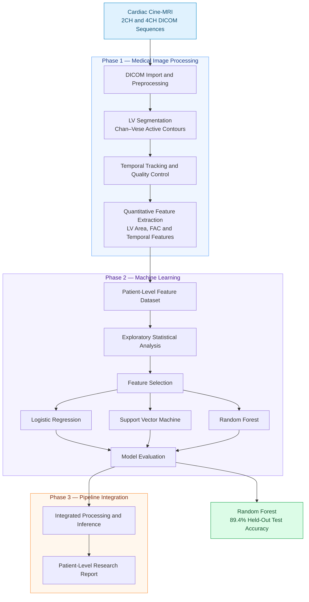

# Cardiac Cine-MRI Analysis and Exploratory Classification

*A MATLAB-based pipeline for left ventricular segmentation, functional feature extraction, and machine learning classification.*

## Project Overview

This project develops an integrated MATLAB framework for analyzing cardiac cine-MRI sequences, extracting quantitative measures of left ventricular (LV) function, and investigating their potential to distinguish healthy subjects from patients with myocardial infarction (MI).

The workflow combines medical image processing, semi-automatic segmentation, temporal tracking, statistical analysis, and machine learning into three interconnected phases.

## Research Objectives

- Develop a reproducible workflow for processing 2D cardiac cine-MRI sequences.
- Segment and track the LV cavity throughout the cardiac cycle.
- Extract quantitative features describing LV geometry and temporal area changes.
- Investigate differences in imaging-derived features between healthy and MI cohorts.
- Develop and evaluate machine learning classifiers using patient-level validation.

## Research Workflow

## Methodology

### Phase 1 — Image Processing and Feature Extraction

Cardiac cine-MRI sequences acquired in 2-chamber (2CH) and 4-chamber (4CH) views are processed through:

1. **DICOM Import and Preprocessing:** Temporal ordering, metadata validation, intensity preprocessing, and image quality inspection.
2. **LV Segmentation:** Manual contour initialization followed by Chan–Vese active-contour refinement.
3. **Temporal Tracking:** Propagation of segmentation masks across cardiac frames using a cyclic tracking strategy.
4. **Quantitative Analysis:** Extraction of end-diastolic and end-systolic LV cavity areas, fractional area change (FAC), and temporal area-curve features.
5. **Quality Control:** Visual inspection of segmentation masks and comparison with reference contours where available.

### Phase 2 — Statistical Analysis and Machine Learning

Patient-level imaging features are used for exploratory classification.

- **Exploratory analysis:** Feature distributions, correlations, class balance, and between-group comparisons.
- **Feature selection:** Correlation-based, univariate, and model-based methods.
- **Classification:** Logistic Regression, Support Vector Machines (SVM), and Random Forest.
- **Evaluation:** Patient-level cross-validation, held-out test-set evaluation, confusion matrices, sensitivity, specificity, F1-score, and ROC-AUC.
- **Interpretation:** Feature importance and model coefficient analysis.

### Phase 3 — Integrated Pipeline

The final phase connects image processing, feature extraction, and classification into a unified MATLAB workflow.

The integration modules support patient-level feature generation, model serialization, optional classifier inference, output validation, and research report generation.

## Technologies and Methods

- **Programming:** MATLAB
- **MATLAB Toolboxes:** Image Processing Toolbox, Statistics and Machine Learning Toolbox
- **Medical Imaging Software:** Segment, RadiAnt DICOM Viewer
- **Medical Imaging Techniques:** DICOM processing, cardiac cine-MRI, image preprocessing, active-contour segmentation, temporal tracking
- **Machine Learning:** Logistic Regression, SVM, Random Forest, feature selection, cross-validation, model evaluation

## Repository Structure

- `Cardiac_MRI_Phase1/` — DICOM processing, LV segmentation, tracking, and feature extraction
- `Cardiac_MRI_Phase2/` — Statistical analysis, classification, and model evaluation
- `Cardiac_MRI_Phase3/` — Pipeline integration, inference, and reporting

Each phase includes its own documentation and MATLAB source files.

## Project Status and Results

The three-phase MATLAB workflow was developed for cardiac cine-MRI analysis and exploratory Healthy-versus-MI classification.

The experiments achieved a reported classification accuracy of 89.4% on a test set.

## Research Limitations

This project is intended for exploratory research rather than clinical diagnosis. Its limitations include the use of 2D cine-MRI views, semi-automatic segmentation requiring quality control, and the need for independent external validation to establish generalizability.

Fractional area change is an area-based measurement and should not be interpreted as volumetric ejection fraction.

Patient imaging data and clinical records are not included in this repository.

## License

To be determined based on project ownership and institutional permissions.
